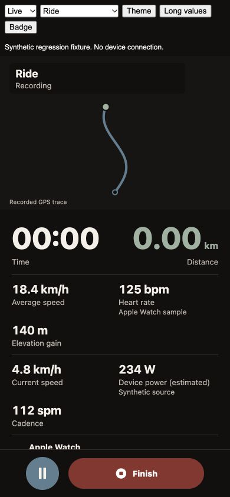
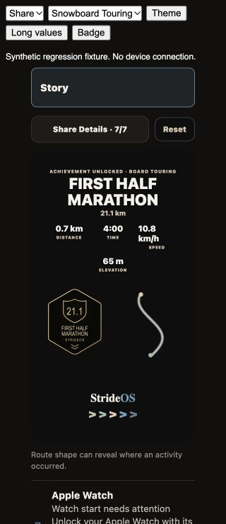

# October 17 Activity Corrections

Canonical checkout: `/Users/drew/Developer/StrideOS_App_clean_build19_v3_foundation_local`.
Starting commit: `1fca75b8cb257866fc6d2aaeec0ca71d785ca792`.
Release candidate: 1.0.0 (94). Fresh user authorization on October 18 covers commit, push, EAS build and TestFlight submission. See [release status](RELEASE.md) for verified progress and identifiers.

## Scope And Decisions

1. Replace repeated blocking Watch launch alerts with an inline status, explicit unlock/open/retry guidance, and expandable full diagnostics. Wait briefly for connection activation and advertised sport capabilities before sending the existing native start. Coalesce duplicate requests and reject stale, paused, ended, replaced, or wrong-owner requests. Reachability never means confirmed recording or live heart rate.
2. Add optional elevation gain to manual entry and editing, in settings-based meters or feet. Preserve blank versus zero and reject invalid or negative input. Preserve existing activity identity, source, raw route, sensor samples, timestamps, and untouched elapsed seconds when editing a recording. Do not turn a planned route into fabricated recorded GPS.
3. Automatically estimate supported post-workout power from the active athlete's saved weight. Remove the per-workout cycling-weight checkbox. Preserve measured/device power and existing valid estimates. Snapshot model version, mass, provenance and calculation time; subsequent profile changes do not rewrite historical estimates. Activity corrections reuse the original mass snapshot.
4. For walking/hiking, calculate climbing work `m g h` in kJ and average climbing-component power `m g h / t` in W when ascent and valid time exist. State the time denominator and exclusions. This is not total human power or calories. Skiing and other unsupported sports do not inherit a running/cycling equation.
5. Restore 53-point nominal primary live values and 20-point secondary values. Reflow cells before reducing type; preserve an effective 40-point primary/18-point secondary floor, accounting for native font scale and inline units. Remove native text autoshrink from live readouts and share titles. Paused Training metrics scroll independently of Resume/Stop controls. Reset only the setup presentation scroll subtree on idle/environment transitions, not the active workout owner.
6. Share controls now use full-width-capable, growing options rather than three narrow columns. Square artwork uses a fixed 360x360 artboard; fixed activity Story uses 360x640. Both scale uniformly into the preview, preserving export shape. Artwork text has fixed export scaling; controls retain accessibility scaling. Activity + Achievement Story reserves separate badge/route regions, with extra clearance for five metrics. Long titles move the activity prefix into context before bounded explicit type reduction. Route remains Story-only and off by default.

## Weight Migration

- Explicitly saved weights have provenance. Legacy non-default values may migrate as inferred inputs, with unknown entry date disclosed.
- Legacy unmarked 70/75 kg defaults are not assumed to be athlete-entered. Enter/save the current weight once in More > Profile if needed.
- Secondary-athlete saves must never overwrite the original athlete's global onboarding weight. Independent review reproduced that defect; it is now fixed and covered in both hydration orders.
- Existing retained-owner storage can persist same-owner state after logout. Review did not reproduce cross-owner transfer; conflicting owners remain denied. This work does not promise zero post-logout writes.

## Council Record

Scores are bounded review-rubric judgments, not measured probabilities of device reliability.

- R1: Design initially requested revision (80/100). Amendments removed native autoshrink, restored hierarchy, added whole-word control reflow, and preserved session ownership. Amended plan passed 95/100. Watch self-review passed 96/100; manual/power plan passed 95/100.
- R2: Independent design review required Story/title budgets, native-scale-aware fitting, and reachable paused controls. Those findings were corrected. Independent general review found the secondary-athlete weight overwrite, blocking that scope until its fix. Parent source/design passed 95/100; general parent review passed 97/100.
- R3: Independent review reran the 82 kg default / 100 kg secondary-athlete reproduction in both hydration orders; both remain correct after relaunch. General closure passed a bounded 96/100; Design/Contrarian closure passed 95/100. Design independently verified 12/12 Story browser cases and reviewed the refreshed inline-unit live screenshot. Browser visual findings are closed; native device and native image-export proof remain separate.

## Verification

- Full suite: 968/968 passed, no skips or failures, with test concurrency 2. This includes the production Swift deadline probe. The initial unconstrained run exhausted its 30-second Swift probe timeout; the bounded run passes.
- Semantic typecheck: exit 0 using the repository TypeScript 5.9.3 command.
- iOS Hermes export: exit 0, 10 MB bundle at `/tmp/strideos-oct17-export-verified`.
- `git diff --check`: pass.
- Protected native Watch, iOS connectivity module and `WatchWorkoutBridge.tsx`: no source diff from the starting commit. Native control transport, provisional adoption, queued commands and completion ownership remain intact.
- Browser: actual shared components at 320/390/430 px; long duration/distance/source strings; full share-option labels; square long-value/five-metric bounds; four Story variants with five metrics, badge and route; Watch details/retry and paused state. Saved geometry reports no horizontal overflow and positive layer clearance.
- Native-text element tests exercise measured layouts at fontScale 1/1.3/2, including inline units. They are not native screenshot certification.

Logs: `/tmp/strideos-oct17-tests-verified.log`, `/tmp/strideos-oct17-typecheck.log`, `/tmp/strideos-oct17-export-verified.log`.
Browser evidence: [Story geometry](story-matrix.json), [live widths](live-matrix.json), [live preview](live-390.jpg), [Story preview](story-320.jpg).
The QA fixture is synthetic, not a connected Watch or a real workout. Its generated browser bundle is ignored by Git/EAS.

## Device Test Guide

Use build 94 containing these changes, not the earlier TestFlight build 93. Check [release status](RELEASE.md) for availability.

1. More > Activity > Track Workout: start Run, Walk, Ride, Hike, Downhill Ski, Cross-Country Ski, Snowboard, Ski Touring and Snowboard Touring. With Watch locked/unreachable, phone recording must continue without a blocking Watch alert. Check the inline status and complete error details.
2. Unlock the Watch, open StrideOS on it, then tap Retry in the phone's Watch row. Require matching recording confirmation and actual heart-rate samples; do not equate reachability with either. Pause/Resume/Finish must affect the same single workout. Repeat through Running > Active.
3. More > Activity > plus (Log activity): enter a hike with duration, distance and optional elevation. Confirm units follow Settings. Test blank, zero, positive and invalid elevation. Save and reopen. With verified profile weight, climbing kJ and climbing-component W should appear without another mass form.
4. Open an existing recorded activity > Edit: change only elevation. Confirm exact route, raw samples, duration, timestamps and record identity remain intact. Reopen after relaunch. This must not add duplicate workouts.
5. Open a recorded run/ride with eligible GPS speed and grade: confirm automatic model output and provenance. Measured/device power wins when available. Change profile weight and reopen an already calculated activity: its historical mass/version/timestamp must remain unchanged. Unsupported or insufficient-data estimates must remain unavailable rather than inventing GPS or a flat grade.
6. More > Profile: save weight, restart, and verify it in Profile/Settings. For multiple athletes, changing the second athlete must not alter the default athlete, including after restart.
7. Running > Active: verify 00:00 and 0.00 are visible, map/setup can scroll to the top, and changing Indoor/Outdoor resets only setup presentation. During a workout, verify readable time/distance/secondary metrics at normal and large text sizes. Pause with long values and ensure Resume/Stop remain reachable.
8. Activity detail > Share Image: check Minimal/Transparent Overlay/Editorial, Square/Story and five selected metrics. HIKING must be readable; Transparent Overlay must not split midword. Square has no route; Story can opt into the route. Also test Activity + Achievement from an earned achievement, Route on/off, image export framing and transparent alpha.

## Remaining Boundaries

The October 17 correction turn did not build or submit a binary. The user subsequently authorized release on October 18; that release is tracked separately. Physical iPhone/Watch testing, native Dynamic Type screenshots and native image-export fidelity remain unverified. JavaScript cannot unlock a Watch or bypass passcode/Health restrictions.

Primary platform references: [Expo SDK 56](https://docs.expo.dev/versions/v56.0.0/), [Apple Watch app launch](https://developer.apple.com/documentation/healthkit/hkhealthstore/startwatchapp(with:completion:)), [Watch reachability](https://developer.apple.com/documentation/watchconnectivity/wcsession/isreachable), [Watch passcode](https://support.apple.com/en-gb/guide/watch/apd0e1e73b6f/26/watchos/26). Existing power-model research is recorded in `docs/handoff/UPDATE_2026_10_15_RESEARCH.md`.

## Local Visual Evidence

